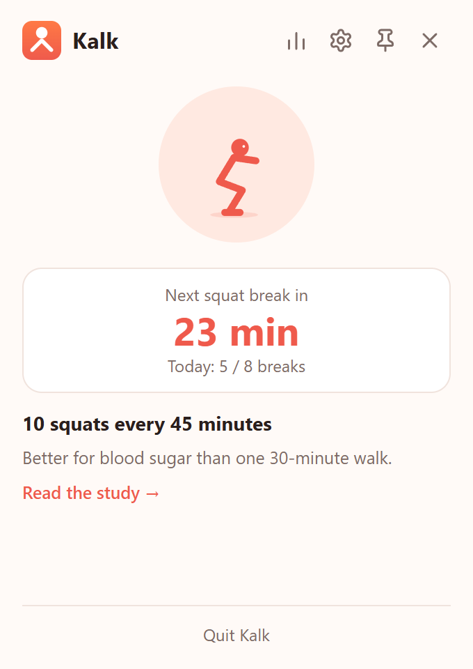
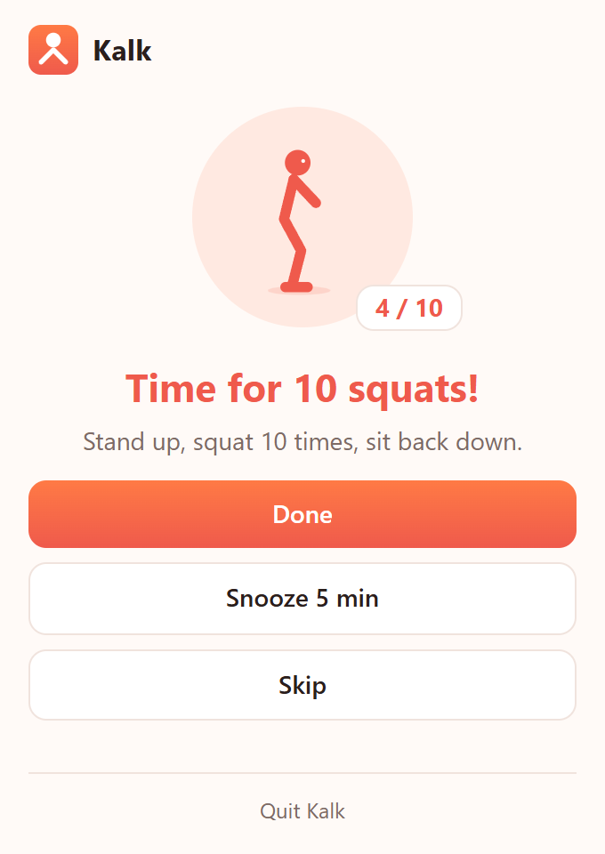
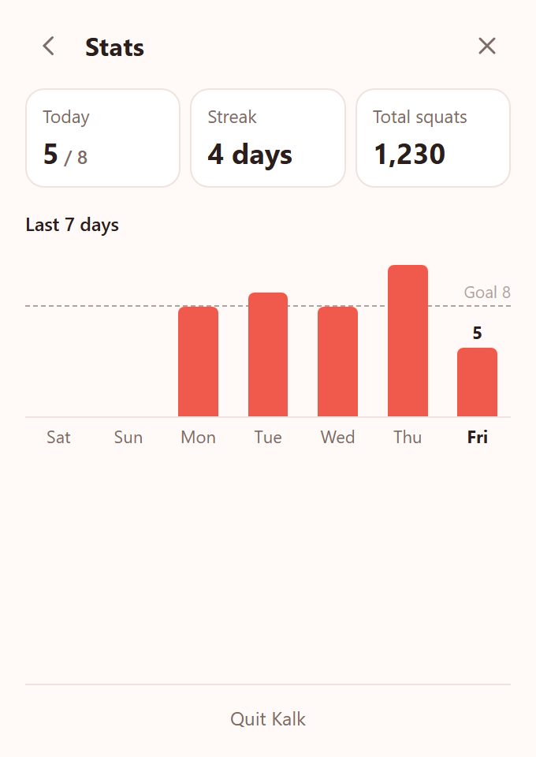

# Kalk

**Kalk** (Turkish for *"get up!"*) sits in your tray / menu bar and reminds you
to do **10 bodyweight squats after every 45 minutes** of active computer use.

> A 2024 study ([Scand J Med Sci Sports, doi:10.1111/sms.14628](https://doi.org/10.1111/sms.14628))
> found that breaking up 8.5 hours of sitting with 10 squats — or a 3‑minute
> walk — every 45 minutes lowered blood‑sugar response more than a single
> 30‑minute walk. (18 men with overweight or obesity — a small study, so treat
> it as a nudge, not a promise.)

Windows and macOS. Everything stays on your machine — no accounts, no telemetry.

<p align="center">
  <picture>
    <source media="(prefers-color-scheme: dark)" srcset="docs/screenshots/info-dark.png">
    
  </picture>
  <picture>
    <source media="(prefers-color-scheme: dark)" srcset="docs/screenshots/reminder-dark.png">
    
  </picture>
  <picture>
    <source media="(prefers-color-scheme: dark)" srcset="docs/screenshots/stats-dark.png">
    
  </picture>
</p>

**Website:** https://besinci.github.io/kalk/

## What it does

- **Counts only real computer time.** The timer runs while you're using the
  keyboard or mouse. Step away for 10 minutes, or put the machine to sleep, and
  it starts over — you already got up.
- **Reminds you without getting in the way.** When it's time, a small popup
  opens next to the tray icon with a chime. It doesn't steal keyboard focus, so
  you can finish your sentence. **Done**, **Snooze 5 min** or **Skip**.
- **Squat along.** An animated character does the reps with a counter.
- **Notices when you walked away.** Left a reminder open and came back later?
  Kalk asks whether you did your squats.
- **Respects your day.** Active hours (default Mon–Fri, 09:00–18:00), plus
  *Pause for 1 hour* and *Pause for today* from the tray menu.
- **Stats.** Today against your daily goal, your streak, the last 7 days and
  total squats.
- **English and Türkçe**, following your system language.

Everything is adjustable in settings: interval, reps, daily goal, idle reset,
snooze length, active hours and days, launch at login, sound and language.

## Install

Download the latest release from
[Releases](https://github.com/besinci/kalk/releases/latest):
`Kalk_<version>_x64-setup.exe` for Windows 10/11, or
`Kalk_<version>_universal.dmg` for macOS 11+ (Intel and Apple Silicon).
Builds of the latest `main` are on the
[Actions tab](https://github.com/besinci/kalk/actions/workflows/build.yml).

- **Windows:** the installer is unsigned, so SmartScreen will warn you —
  *More info → Run anyway*.
- **macOS:** the build isn't notarized yet — right‑click the app → *Open* the
  first time.

## Privacy

Kalk reads only *how long ago* you last touched the keyboard or mouse — never
what you typed or where you clicked. Settings and the break log are stored
locally (`settings.json` and `kalk.db` in the app data folder:
`%APPDATA%\io.github.besinci.kalk` on Windows,
`~/Library/Application Support/io.github.besinci.kalk` on macOS). Nothing is
sent anywhere.

## Development

Requirements: [Rust](https://rustup.rs) (stable), Node.js 20+, and the
[Tauri prerequisites](https://tauri.app/start/prerequisites/) for your OS.

```sh
npm install
npm run tauri dev               # run with hot reload; click the tray icon
KALK_SHOW=1 npm run tauri dev   # open the popup immediately
npm run tauri build             # release build + installer
npm run check                   # type-check the UI
cd src-tauri && cargo test      # timer, log and stats tests
```

**Debug builds run fast:** every minute in the settings counts as a second (a
reminder after 45 s, snooze 5 s), the idle reset is at least 30 s, active
hours are ignored and launch at login is left alone. Release builds use real
minutes.

### Layout

```
src/
  routes/+page.svelte   the popup: info, reminder, settings and stats views
  lib/Squatter.svelte   the animated character
  lib/Settings.svelte   settings view
  lib/Stats.svelte      stats view
  lib/i18n.svelte.ts    popup strings (en, tr)
src-tauri/src/
  lib.rs                app setup, plugins, window/run events
  timer.rs              the break timer: pure logic, fake-clock tests
  breaks.rs             runs the timer; commands for the popup; tray tooltip
  idle.rs               system idle time (Windows / macOS)
  settings.rs           settings.json
  db.rs                 SQLite break log
  stats.rs              streak and 7-day stats
  popup.rs              popup show/hide, reminder mode, positioning
  tray.rs               tray icon + right-click menu
  i18n.rs, sound.rs     tray strings, reminder chime
assets/                 icon sources
```

Icons: `python3 assets/make_icons.py assets && npx tauri icon assets/app-icon.png`
then copy `assets/tray-*.png` into `src-tauri/icons/`.

See [PLAN.md](PLAN.md) for the roadmap.

## License

MIT
